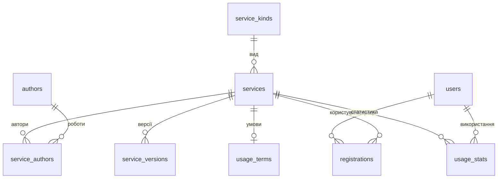
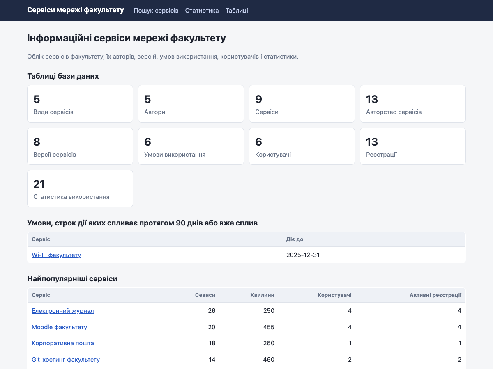
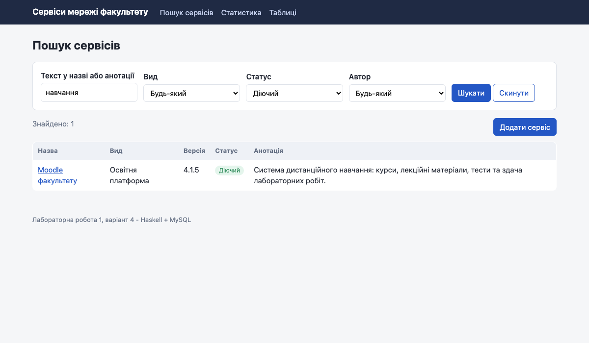
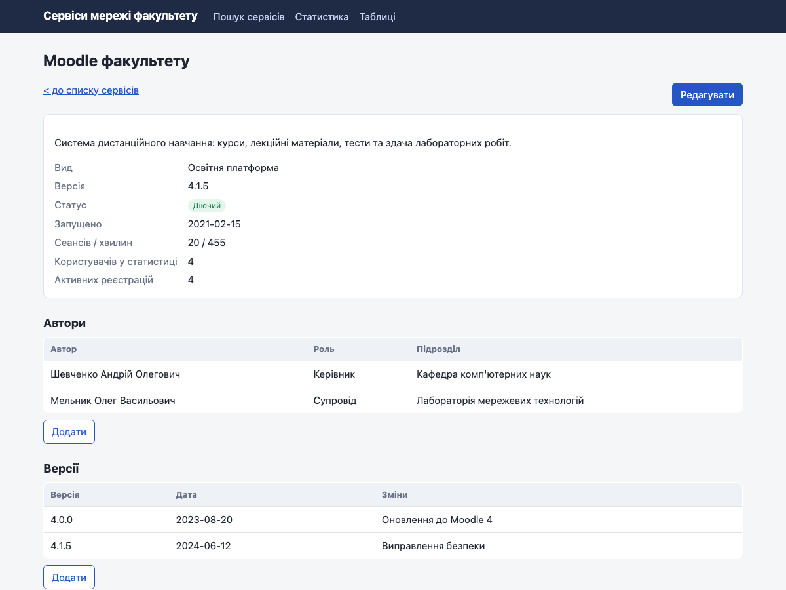
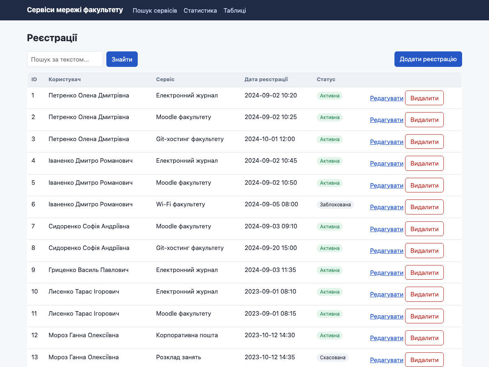
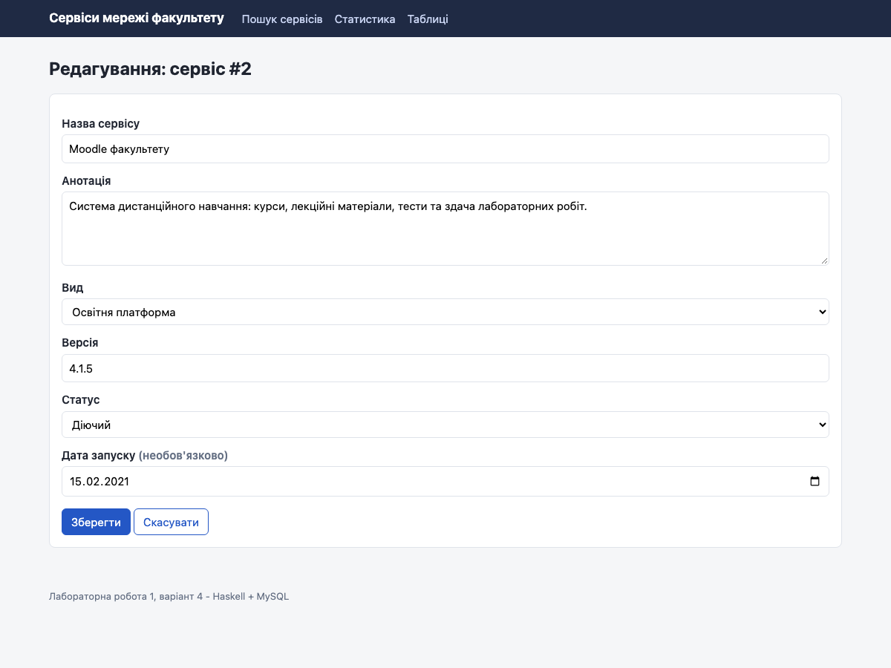
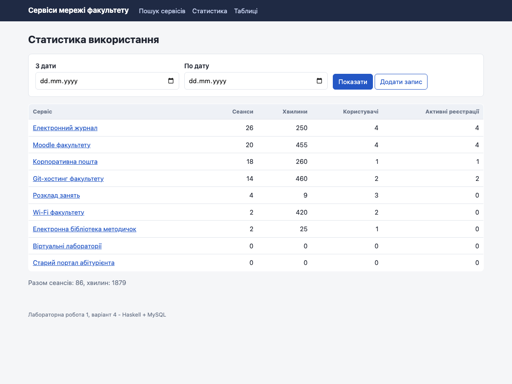

# Інформаційні сервіси мережі факультету

Лабораторна робота №1 з функціонального програмування, **варіант 4**.
Мова: Haskell. База даних: MySQL 8. Інтерфейс: веб-застосунок (Scotty + blaze-html).

## Завдання

> Створити програму на Haskell, використовуючи classes і instances. Як БД використовувати MySQL.
> Розробити інформаційну систему «Інформаційні сервіси мережі факультету». Таблиці БД містять
> таку інформацію: назва сервісу, автор, текст анотації, вид, версія, умови, кінцевий термін та
> правила використання, інформація при реєстрації користувачів, статистика використання.
> Передбачити можливість введення та коригування інформації. Кількість таблиць повинна бути більше 5.

## Ідея

Факультет має набір внутрішніх сервісів: електронний журнал, Moodle, розклад, Wi-Fi, пошта,
Git-хостинг, бібліотека методичок тощо. Система веде їх облік:

- каталог сервісів з анотацією, видом, версією та статусом;
- автори сервісів (зв'язок «багато до багатьох») та історія випусків версій;
- умови, правила й кінцевий термін використання;
- користувачі, їхня реєстрація в сервісах;
- статистика використання (сеанси та хвилини за днями) і зведені звіти.

Дані можна вводити й коригувати у веб-формах, шукати сервіси за текстом, видом, статусом і автором.

## Таблиці бази даних (9)



| Таблиця | Призначення | Основні поля |
|---|---|---|
| `service_kinds` | довідник видів сервісів | назва, опис |
| `authors` | автори сервісів | ПІБ, email, посада, підрозділ |
| `services` | **сервіси** | назва, анотація, вид (FK), поточна версія, статус, дата запуску |
| `service_authors` | авторство (M:N) | сервіс (FK), автор (FK), роль |
| `service_versions` | історія версій | сервіс (FK), версія, дата випуску, перелік змін |
| `usage_terms` | умови, правила, кінцевий термін | сервіс (FK, 1:1), умови, правила, дійсні до |
| `users` | користувачі (дані реєстрації) | ПІБ, email, роль, група, дата реєстрації |
| `registrations` | реєстрації користувачів у сервісах | користувач (FK), сервіс (FK), дата, статус |
| `usage_stats` | статистика використання | сервіс (FK), користувач (FK), дата, сеанси, хвилини |

Повна схема: [`sql/001_schema.sql`](sql/001_schema.sql), тестові дані: [`sql/002_seed.sql`](sql/002_seed.sql).
Обмеження цілісності: зовнішні ключі, унікальні ключі (`email`, пара «сервіс - автор», пара «користувач - сервіс»),
`CHECK` на невід'ємність статистики, `ENUM` для статусів і ролей.

## Як виконано вимоги

| Вимога | Реалізація |
|---|---|
| **Haskell** | Увесь код у `src/`, `app/`, `test/`; збірка через Cabal. |
| **Класи й екземпляри (classes / instances)** | Власні класи в [`src/Domain/Entity.hs`](src/Domain/Entity.hs): `Entity`, `Validatable`, `Labelled`, `Enumerated`, `ToValue`, `FromValue`. Екземпляри для кожної з 9 таблиць у [`src/Domain/Instances.hs`](src/Domain/Instances.hs), для переліків (`ServiceStatus`, `AuthorRole`, `UserRole`, `RegStatus`) у [`src/Domain/Model.hs`](src/Domain/Model.hs). |
| **MySQL як БД** | MySQL 8 у `docker-compose.yml`, драйвер `mysql-haskell` (чистий Haskell, без `libmysqlclient`), пул з'єднань `resource-pool`, підготовлені запити з параметрами. |
| **Більше 5 таблиць** | 9 таблиць (див. вище). Тест перевіряє, що в реєстрі сутностей їх більше п'яти. |
| **Назва, автор, анотація, вид, версія** | `services`, `authors`, `service_authors`, `service_kinds`, `service_versions`. |
| **Умови, кінцевий термін, правила використання** | `usage_terms`; на головній сторінці показано умови, що спливають або вже спливли. |
| **Інформація при реєстрації користувачів** | `users` і `registrations`. |
| **Статистика використання** | `usage_stats` + звіт `/usage` (суми, кількість користувачів, фільтр за періодом). |
| **Введення та коригування інформації** | Форми створення й редагування для кожної таблиці, видалення, перевірка введених даних і зрозумілі повідомлення про помилки БД. |
| **Пошук** | `/services`: текст у назві чи анотації, вид, статус, автор; на сторінці кожної таблиці є пошук по всіх текстових полях. |

### Як працюють класи

Кожна таблиця - це звичайний тип даних (`Service`, `Author`, ...) плюс екземпляри кількох класів:

```haskell
class Entity a where
  tableName     :: Proxy a -> Text          -- назва таблиці в MySQL
  titlePlural   :: Proxy a -> Text          -- заголовок для інтерфейсу
  fieldSpecs    :: Proxy a -> [FieldSpec]   -- опис колонок: назва, підпис, вид поля
  entityId      :: a -> Int64
  toValues      :: a -> [FieldValue]        -- запис -> значення колонок
  fromValues    :: Int64 -> [FieldValue] -> Either Text a

class Validatable a where validate :: a -> [Text]   -- бізнес-правила
class Labelled a where    label    :: a -> Text     -- підпис у списках вибору
class (Bounded a, Enum a) => Enumerated a where     -- ENUM-значення
  enumCode  :: a -> Text
  enumLabel :: a -> Text
```

Завдяки цьому весь CRUD **універсальний**: SQL (`INSERT`, `UPDATE`, `SELECT`, `DELETE`), розбір форм,
таблиці й форми в HTML будуються з `fieldSpecs`, а не пишуться окремо для кожної сутності. Різні типи
збираються в один список через екзистенційну обгортку `SomeEntity` (реєстр у
[`src/Domain/Registry.hs`](src/Domain/Registry.hs)). Щоб додати десяту таблицю, достатньо описати тип,
його екземпляри й один рядок у реєстрі.

Приклади бізнес-правил `Validatable`: версія має вигляд `1.2` або `1.2.3`; діючий чи застарілий сервіс
повинен мати дату запуску; студент мусить мати групу; у статистиці не більше 1440 хвилин за добу
і не може бути хвилин без сеансів.

## Структура проєкту

```
app/Main.hs               запуск: налаштування, пул з'єднань, сервер
src/Config.hs             змінні середовища та .env
src/Domain/Entity.hs      класи Entity, Validatable, Labelled, Enumerated, ToValue/FromValue
src/Domain/Model.hs       типи даних (по одному на таблицю) і переліки
src/Domain/Instances.hs   екземпляри класів для всіх таблиць
src/Domain/Form.hs        розбір значень форм за описом полів
src/Domain/Registry.hs    реєстр усіх сутностей
src/DB/Convert.hs         FieldValue <-> значення драйвера MySQL
src/DB/Repository.hs      універсальні запити та пул з'єднань
src/DB/Reports.hs         пошук сервісів, статистика, терміни дії
src/Web/Views.hs          HTML-сторінки (blaze-html)
src/Web/App.hs            маршрути Scotty
sql/                      схема й тестові дані
scripts/smoke.sh          наскрізна перевірка проти реальної MySQL
test/Spec.hs              модульні тести чистої частини
```

## Запуск

Потрібні: GHC 9.x і Cabal 3.x (перевірено на GHC 9.14.1 та Cabal 3.18) і Docker.

```bash
# 1. MySQL 8 у контейнері (порт 3407 на хості); схема й дані завантажуються автоматично
docker compose up -d --wait

# 2. Збірка й запуск застосунку
cabal build
cabal run faculty-services
# відкрийте http://localhost:3000
```

Налаштування (необов'язково) беруться зі змінних середовища або з файлу `.env`
(зразок - [`.env.example`](.env.example)): `DB_HOST`, `DB_PORT`, `DB_USER`, `DB_PASSWORD`, `DB_NAME`, `APP_PORT`.
Значення за замовчуванням збігаються з `docker-compose.yml`.

Скинути базу до початкового стану: `docker compose down -v && docker compose up -d --wait`.
Зупинити: `docker compose down`.

> У `cabal.project` вимкнено перевірку верхніх меж версій (`allow-newer`) лише для `mysql-haskell` та його
> кількох залежностей: пакет ще не оголосив підтримку нових версій `base`. Код від цього не змінюється.

## Тестування

```bash
# Модульні тести (чиста частина, без БД): екземпляри, розбір форм, правила, генерація SQL
cabal test

# Наскрізний тест: створення, читання, пошук, редагування й видалення через HTTP + перевірка в MySQL.
# Потрібні запущені контейнер БД і застосунок.
./scripts/smoke.sh                           # застосунок на http://localhost:3000
BASE_URL=http://localhost:3055 ./scripts/smoke.sh
```

Скрипт створює власні тестові записи з унікальним суфіксом і видаляє їх наприкінці,
тому не псує наявні дані.

## Знімки екрана

| Головна | Пошук сервісів |
|---|---|
|  |  |

| Картка сервісу | Список реєстрацій |
|---|---|
|  |  |

| Форма редагування | Статистика |
|---|---|
|  |  |
